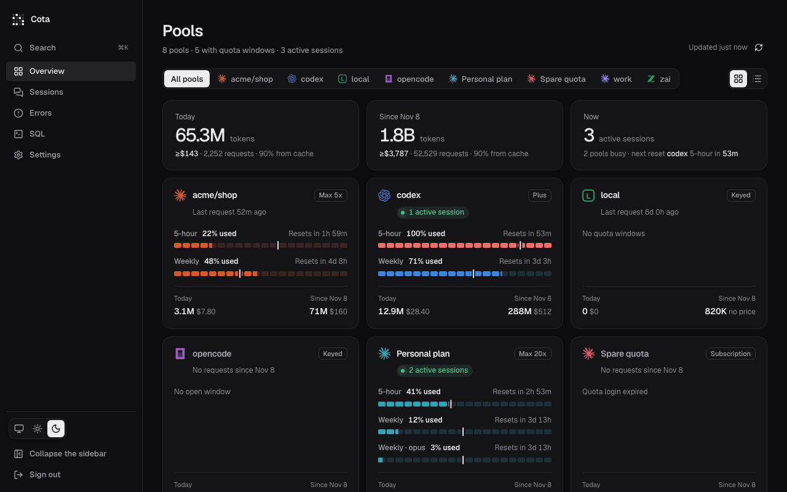

# Cota

Cota is a hub you run yourself for the AI coding subscriptions and API plans you hold. Every machine you work on sends Claude Code, Codex, OpenCode and Pi through it: the hub forwards each client's own login to that client's own provider, bills each project to the subscription you chose for it, keeps every request and conversation in a request log you can search, and shows every plan's quota windows in one dashboard.



It is for a developer with more than one subscription, or more than one machine, who will run two containers and wants one place to see and search all of it.

Cota is not released yet: there are no published images or binaries, and you build both from this repository. [The state of the project](#the-state-of-the-project) says what has been run, and where.

```text
   laptop                   desktop                  any other machine
   claude  codex            opencode  pi             ...
   (each machine runs `cota`, which launches its clients through the hub)
        \       |              |       /
         \      |              |      /
          the hub, with its ClickHouse (two containers, on one machine you keep on)
         /         |              |              \
   Anthropic    ChatGPT      Z.ai, OpenCode Go    a model server of your own
```

## What it looks like

The hub serves a dashboard at its own address, behind the owner password or a passkey. Its first screen is every pool's quota windows, each drawn as twenty blocks with a mark where even use would be, beside the traffic of the range you choose and the range before it. From there: the sessions of every machine, searched and filtered by project, model, client or machine; a session's timeline and its transcript; a request in full, from its cost to its tool calls; the errors grouped by cause; a SQL console over the request log; and Settings, where you name pools, models and projects, set which project bills which pool, and manage the ways you sign in. A command palette (`⌘K`, `Ctrl+K` or `/`) reaches any of it. The tour above is the dashboard itself, drawn from the constructed sample data its stories use, not from anyone's account.

## What it does

- **Forwards each client with its own login.** Claude Code with its Claude subscription (Pro or Max), or an Anthropic API key or OpenRouter key the hub holds. Codex with its ChatGPT login: answers, the model list, web search and image generation. OpenCode and Pi with keys the hub holds for Z.ai, OpenCode Go, or an OpenAI-compatible server of your own. The hub never converts one provider's protocol to another's.
- **Bills the right pool.** A pool is what a request bills: one subscription, one API plan, or one local server. Routes on the hub say which pool each project bills (`acme/*` on the work subscription, the rest on your own), so every machine agrees. One launch can name another pool, and `COTA=off` starts a client as if Cota were not there.
- **Keeps a session working at a limit.** When a provider refuses a login because a quota window is full, the hub can send that login's requests to a fallback pool you name, with a login you gave it for that pool, until the window resets.
- **Shows every quota window.** How much of each window is used, whether that is on pace, and when it resets. Claude's and ChatGPT's come from the headers of their answers, or, with a quota login you give the hub, from the provider as its own client shows them, per-model windows and the plan's name included. Z.ai's and OpenCode Go's are read with the keys the hub holds.
- **Remembers everything.** Every request with its usage, its cost at list price (for a subscription, what it would have cost, not a bill), its latency and its outcome, and every conversation, kept once per session. Each session has its title, as Claude Code, Codex and T3 Code name it on the machine. Search finds the words of any conversation; SQL answers anything else, read-only.
- **Keeps a copy of each day.** The hub archives each ended day of the request log to files you can read with `zstd` and `jq`, and a restore puts a lost day back.
- **Lets your agents remember.** With a reader key, a coding agent on any machine can search past sessions and read their transcripts through `cota memory`, using the skill in [`skills/cota-memory`](skills/cota-memory/SKILL.md).
- **Sets each machine up.** `cota join` puts shims for `claude`, `codex`, `opencode` and `pi` first on your `PATH`, configures Codex, OpenCode and Pi for the hub, and schedules the title reporter. When the hub cannot be reached, a launch goes straight to the provider with the login its route would have used, and says so; those requests are not logged. `cota doctor` checks the machine and names the command that fixes each problem.

Not built yet: sharing requests across several subscriptions of one provider (load balancing), Codex over a WebSocket (through the hub it uses HTTP), and the published images and binaries. [`docs/roadmap.md`](docs/roadmap.md) has the plan.

## Install

Open a coding agent (Claude Code or Codex) on the machine that will run the hub, in a checkout of this repository, and ask it:

```text
Install Cota for me: follow docs/install.md in this checkout.
```

[`docs/install.md`](docs/install.md) is written for the agent. It asks you, in one message, where the hub runs, which subscriptions and plans it uses, the address your machines reach it at, and which machines join. It then builds the hub image, makes the hub directory and its secrets, starts the hub and its ClickHouse with Docker Compose, and joins each machine. It stops for what only you do: typing each provider's key, setting the owner password in the browser with the setup code, logins for a second subscription, and the routes. It never reads a client's login, and never puts a secret in a command. It is plain steps with their commands, so you can follow it yourself instead. An agent has followed it to a working install in a test world of Linux containers (`docs/verification.md`); no agent has yet installed it on a stranger's machines.

## What it needs

- **The hub's machine**: one that stays on and that every other machine can reach, with Docker and its Compose plugin, Git and [Bun](https://bun.sh). The hub image is built for Linux on arm64 and amd64; it has been built and run on arm64 only, under OrbStack on macOS and in a Docker engine inside a Linux container. Docker Desktop, and Linux running Docker itself, have not run it.
- **Each machine**: macOS or Linux, with Bun to build `cota`, and whichever of Claude Code, Codex, OpenCode and Pi you use. `cota` has run on macOS and on Ubuntu; its Windows parts are built and their pure parts tested, but it has never run on Windows.
- **A quota login for Claude** is given from a Mac, since it is read from the macOS keychain.
- **HTTPS** is your own reverse proxy's: the hub speaks plain HTTP. Passkeys need it. [`docs/recipes/https.md`](docs/recipes/https.md) has a Caddy and an nginx configuration.

## Logins and secrets

Cota sits between you and your providers, so this is what it does with what passes through it.

- **A client's own login passes through.** Claude Code's and Codex's logins reach the hub inside each request and go on to their own provider. The hub keeps a one-way digest of each (a fingerprint), so it can tell which login a provider refused, never the login.
- **The hub keeps only what you give it on purpose**, in the hub directory on its machine (`~/cota-hub`): the keys it holds for API plans and the login of a fallback pool, as files of `secrets/` that only your user can read; and, in the hub store (`store/cota.sqlite`), the owner password's argon2id hash, your passkeys' public keys, your sign-ins' digests, display names, routes and quota logins. A quota login is kept unencrypted and can spend its subscription: guard the hub directory as you guard the secrets in it.
- **The request log holds every conversation in the clear**: every prompt, tool result and answer, including anything secret a client read or printed. It is in ClickHouse's volume and in the archive, both on the hub's machine. Anyone with the owner password, or with a reader key, can read all of it.
- **Hub keys are not logins.** Each machine keeps hub keys that prove it may use the hub. The subscription key spends nothing without a client's own login; the keyed key spends the keys the hub holds; the reader key reads the request log and opens no pool. Over plain `http` to another machine they cross the network in the clear, which the install asks you to accept or refuse.
- **The hub calls nobody but your providers**: their APIs, and for quota windows their usage and token endpoints. It sends no telemetry.
- **A provider's terms are yours to read.** Cota forwards each client's own login to that client's own provider and never converts or resells one. Whether your plan allows a fallback to another of your subscriptions, a quota login read from its usage endpoint (which is undocumented for Claude and ChatGPT), or a login kept on a server, is between you and your provider.

[`SECURITY.md`](SECURITY.md) says how to report a vulnerability.

## Documentation

| | |
| --- | --- |
| [`docs/install.md`](docs/install.md) | The install prompt: a coding agent follows it to install Cota for you |
| [`docs/operating.md`](docs/operating.md) | A deployment day to day: its log, its health, what to copy, the archive and a restore, quota logins, hub keys, SQL, the memory skill, and what to do when something fails |
| [`docs/upgrading.md`](docs/upgrading.md) | Moving to a newer hub image, and going back |
| [`docs/recipes`](docs/recipes/README.md) | What is yours and not Cota's: HTTPS behind your reverse proxy, the hub on a private network, copying the hub directory to another machine, a usage monitor beside the hub |
| [`docs/import.md`](docs/import.md) | Bringing the log of Cota's private prototype into a hub; of use only to that prototype's owner |
| [`docs/development.md`](docs/development.md) | Running a hub from a checkout, against a throwaway ClickHouse, and its API |
| [`docs/verification.md`](docs/verification.md) | How the project is verified |
| [`CONTEXT.md`](CONTEXT.md) | The vocabulary: pool, login, refusal, divert, quota window |
| [`docs/adr`](docs/adr) | Decisions and their reasons |
| [`docs/specs`](docs/specs) | Behaviour and laws, one concept each |
| [`AGENTS.md`](AGENTS.md) | The rules for changing this repository, for people and agents |

## How it is verified

Where Cota decides who pays for a request (whether it is admitted, whether it is diverted, what it cost, where a quota window stands), the decision is a small program with laws in plain sentences, such as *a request without a login is never diverted*, held by property tests, by machine-checked proofs over models of it, and by tests that the shipped code and the proved models agree. Recorded provider traffic is replayed through the real hub. The deployment is brought up from nothing, upgraded and rolled back by a test. Evals have a coding agent follow the install prompt in a world of clean containers, and check that the memory skill's commands find what they are asked. [`docs/verification.md`](docs/verification.md) has the gates, what each shows, and what none of them does.

## The state of the project

Cota is a rewrite, in the open, of a private hub its author used. Everything that hub did is built (the roadmap's parity table).

What has been run, and where:

- Every gate (types, lints, tests, proofs, mutants, the dashboard's stories, and the slow tier: the deployment's test and the evals' rehearsals) passes on one Mac, Apple silicon, with OrbStack. The repository's CI workflow is written but is not running at present, so these are a developer's runs, not CI's.
- The deployment, on that Mac under OrbStack, and in a Docker engine inside an Ubuntu container in the install evals. The recipes were each read against a deployment there (each says how).
- `cota`, on macOS and in Ubuntu containers. Never on Windows.
- Claude Code, as the installer, passed every criterion of the install eval in three of eight runs, the last of them on the deployment the prompt installs now; the others failed on the eval's own faults or ended before they were done ([the install evals spec's Results](docs/specs/install-evals/spec.md#results)). The memory skill's commands find every answer in their scripted eval; no agent has been given the skill yet.

Not proven: real providers' quota logins through the connect script (only fakes of the Claude Code and Codex sign-ins have run it), the hub image on amd64 or under Docker Desktop, and any install on machines other than these.

## Contributing

Read [`AGENTS.md`](AGENTS.md), which holds the rules and the gate for each part of the repository, and [`CONTEXT.md`](CONTEXT.md), whose words the code and docs use. [`CONTRIBUTING.md`](CONTRIBUTING.md) has the rest. Run `bun run check` and the gate your change touches before you open a pull request.

## Licence

MIT, in [`LICENSE`](LICENSE).

Trademarks: provider names and logos, such as Claude's, OpenAI's, Z.ai's, OpenCode's and LM Studio's, belong to their owners, and the dashboard uses them only to identify a pool's provider.
